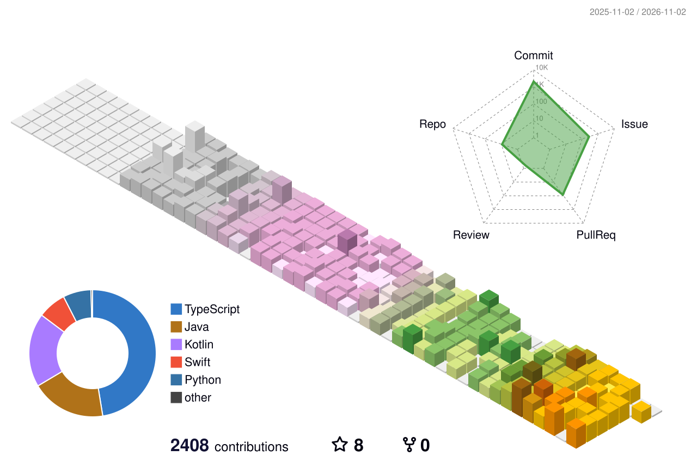

# クォン・イゴン / Kwon Leegun

韓国と日本のあいだで働く人のためのツールを作っています。 
I build tools for people working between Korea and Japan. 
한국과 일본 사이에서 일하는 사람을 위한 도구를 만듭니다.

## About

- 漢城大学（ソウル）コンピュータ工学科 在学中 CS student at Hansung University, Seoul
- 2027年から京都府立大学へ交換留学予定。卒業後は日本で働きたいと考えています Exchange student at Kyoto Prefectural University from 2027, planning to work in Japan
- AI とフルスタック開発が中心です Mainly AI and full-stack development
- 日本語 JLPT N2 ・ English ・ 한국어（母語）

日本語を勉強する中で不便だったこと（敬語のメール、祝日のずれ、単語の整理など）を、そのままプロジェクトにしてきました。 
Most of these projects started from small problems I ran into while learning Japanese.

## Projects

### KOTONA

ビジネス日本語の文章を入力すると、敬語の丁寧さや遠回しな断り（本音と建前）を判定し、返信案を3パターン提案するアプリです。 
Analyzes Japanese business messages for politeness and indirect refusals, and suggests three reply options.

- `Java` `Spring Boot` `Next.js` `TypeScript` `Gemini` `MySQL` `Docker`
- 形態素解析（Kuromoji）のルールと Gemini の判定を組み合わせ、ラベル付きの例文 41 件で精度を確認しています。Gemini の出力は JSON スキーマで固定
- テスト：バックエンド 265 件、フロントエンド 175 件 + E2E 12 件（CI で毎回実行）
- [Demo](https://kotona-web.vercel.app)（サンプルデータで動くデモ版） ・ [kotona-analyzer](https://github.com/2daKaizen-gun/kotona-analyzer) ・ [kotona-web](https://github.com/2daKaizen-gun/kotona-web)

### Pale Blue Code

NASA TESS 衛星の公開データから、まだカタログにない系外惑星を探すアプリです。太陽系の 3D 表示や重力シミュレーションなど、学習用の画面もあります。 
Searches public TESS data for uncatalogued exoplanets, with 3D and simulation views for learning.

- `React` `TypeScript` `Three.js` `GLSL` `D3.js` `FastAPI` `Python` `lightkurve`
- TESS セクター 102–106 の小さな恒星 328 個を調べた結果、目立つシグナル 55 件はすべて観測装置由来のノイズで、惑星候補は 0 件でした。恒星ごとにどのサイズまで検出できたかも合わせて記録しています
- テスト：pytest 244 件、vitest 250 件
- [Demo](https://pale-blue-code.vercel.app)（フロントエンドのみ常時公開） ・ [Repository](https://github.com/2daKaizen-gun/pale-blue-code)

### 冴え (Sae)

90秒の反応時間テスト（PVT）で、その日の頭の冴えを 0–100 で記録する iOS アプリです。ウェアラブル端末は使いません。 
An iOS app that turns a 90-second reaction-time test into a daily alertness score. No wearable needed.

- `Swift` `SwiftUI` `SwiftData` `HealthKit` `CoreMotion` ・ 日本語 / English / 한국어
- 刺激の表示時刻は `CADisplayLink`、タップは `UITouch.timestamp` から取り、描画の遅れが反応時間に混ざらないようにしました
- スコアは元の測定値から計算をたどれるようにしています。テスト 96 件
- [Repository](https://github.com/2daKaizen-gun/sae)

## その他 / Other

| Project | 内容 / What | Stack |
|---|---|---|
| [SkyWear](https://github.com/2daKaizen-gun/skywear) | 韓国と日本の気温差から、旅行の服装を8段階で提案する Android アプリ Outfit suggestions from the KR–JP temperature gap | `Kotlin` `Jetpack Compose` `Hilt` `Room` |
| [JP-KR Schedule Bridge](https://github.com/2daKaizen-gun/jp-kr-schedule-bridge) | 韓日の祝日を並べて表示し、Gemini でビジネスメールの下書きを作成（[Demo](https://jp-kr-schedule-bridge.vercel.app)） KR/JP holiday calendar with Gemini email drafts | `Next.js` `TypeScript` `Gemini` |
| [JP-Dictionary-Bot](https://github.com/2daKaizen-gun/jp-dict-bot) | 単語を入れると JLPT レベルや IT・ビジネスの例文を付けて Notion に保存 Japanese vocabulary notes, synced to Notion | `Python` `Streamlit` `Gemini` `Notion API` |
| [survey-auto-summarizer](https://github.com/2daKaizen-gun/survey-auto-summarizer) | 大学の国際交流プログラムのアンケート（多言語）を集計・要約 Summarizes multilingual survey responses from Google Sheets | `Python` `Pandas` `Gemini` `Sheets API` |

## Tech Stack

**Language**

**Frontend**

**Backend / DB**

**Mobile**

**AI / Data**

**Infra / Tools**

**Testing**

## Activity

 

